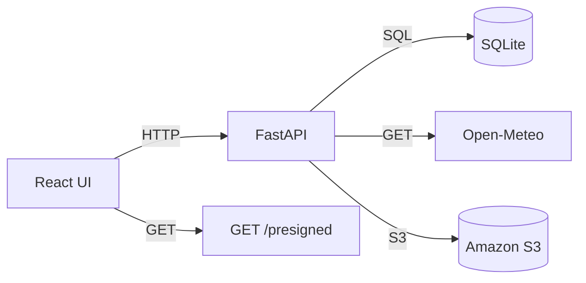

# Architecture Overview

This document explains the high‑level design of **MonsoonReady AI**.

## 1. Overview
- **Frontend** – React (Vite) + TypeScript + Tailwind CSS. Handles UI, routing, and API calls.
- **Backend** – FastAPI (Uvicorn) with SQLite via SQLModel. Exposes REST endpoints for reports, weather, and photo URLs.
- **Database** – `app.db` (SQLite) stores a `Report` table with all incident fields and derived priority fields.
- **Risk Scoring** – Deterministic function `compute_priority` in `backend/app/utils.py` calculates a numeric score, a categorical priority (`HIGH`, `MEDIUM`, `LOW`), and a human‑readable explanation.
- **Weather Integration** – `fetch_weather` calls Open‑Meteo (timeout 5 s) and returns a JSON payload. On any error an empty dict is returned and the UI shows a fallback.
- **Photo Storage** –
  - **Demo Mode** (`LOCAL_DEMO=True`) – uploads are saved under `uploads/` locally and served via a presigned `file://` URL.
  - **AWS Mode** – when `AWS_ACCESS_KEY_ID`, `AWS_SECRET_ACCESS_KEY`, and `S3_BUCKET_NAME` are set, `upload_to_s3` stores the file in S3 and `generate_presigned_url` returns a signed HTTPS URL.
- **Health Endpoint** – `/health` reports `LOCAL_DEMO`, `CONNECTED`, or `NOT_CONFIGURED` based on the environment.

## 2. Component Interaction Diagram

## 3. Future Extensions
- Add authentication (OAuth2) for restricted report editing.
- Real‑time updates via WebSocket.
- Deploy backend to AWS Lambda + API Gateway.
- Add CI/CD pipelines for automated testing and Docker image builds.
